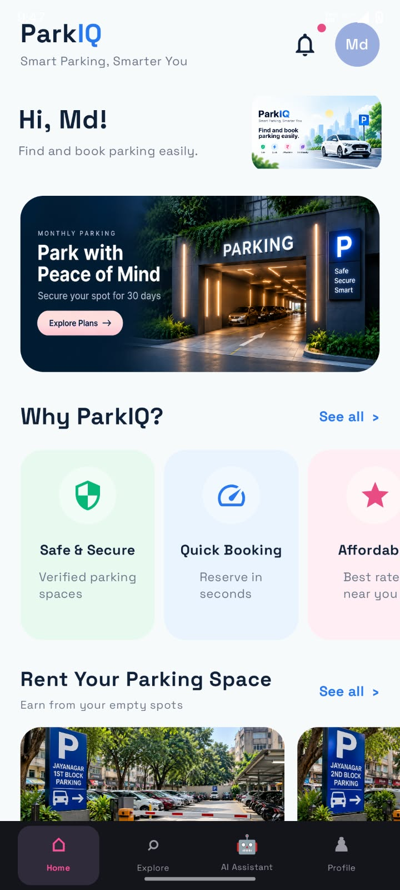
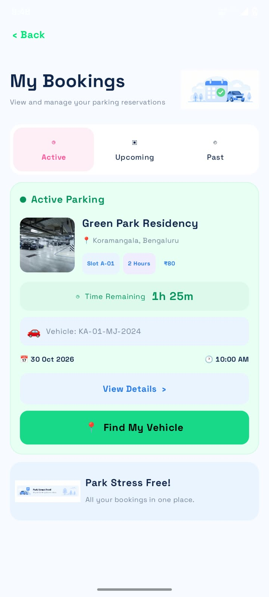
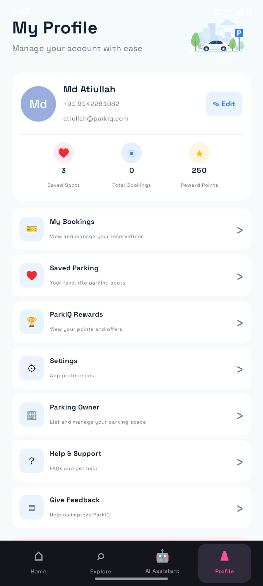
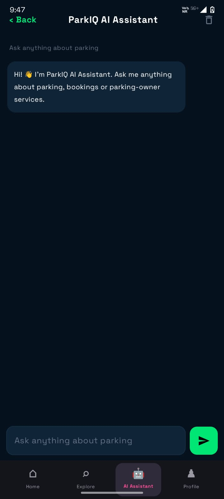
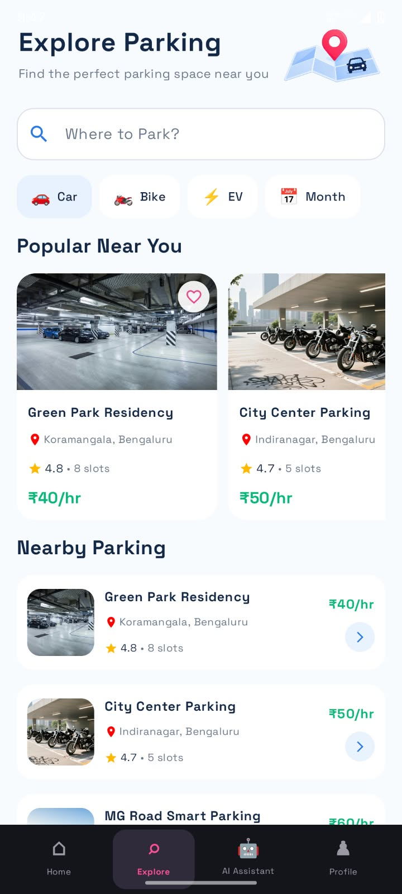
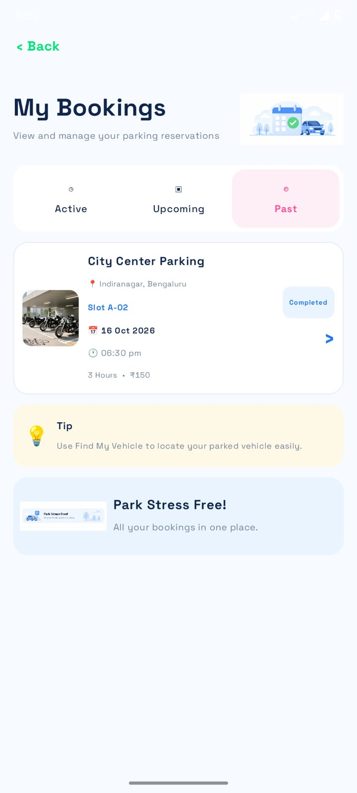
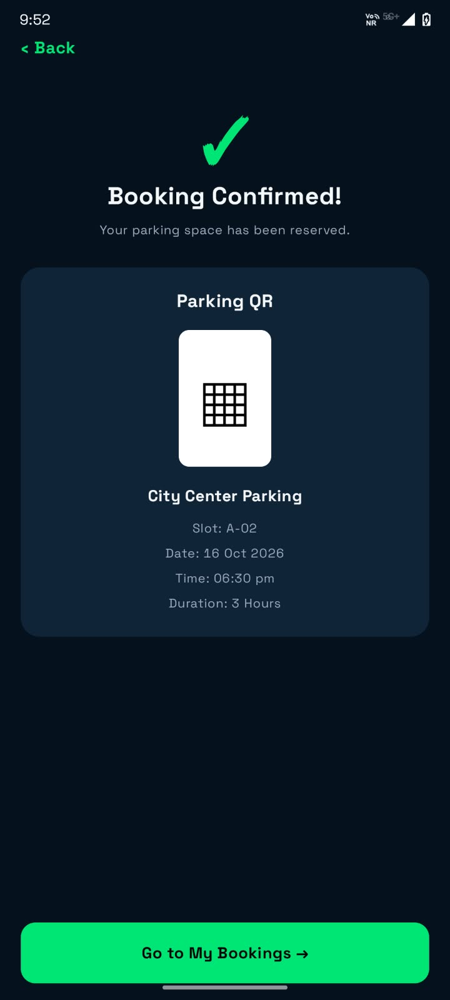

# ParkIQ – Smart Parking Application

## 1. Project Information

- **Project Title:** Smart Parking Management System
- **Application Name:** ParkIQ
- **Platform:** Android
- **Programming Language:** Kotlin
- **IDE:** Android Studio

## 2. Project Overview

ParkIQ is a Smart Parking Management Android application designed to help users find, explore, and reserve parking spaces easily. It provides parking information, slot booking, booking management, parking rental services, and an AI-powered assistant.

The application aims to make parking more convenient by connecting vehicle owners with available parking spaces.

## 3. Objectives

- To help users find available parking spaces.
- To provide parking location and pricing information.
- To allow users to select and reserve parking slots.
- To manage active, upcoming, and past bookings.
- To provide an AI-powered parking assistant.
- To allow parking owners to list their parking spaces for rent.

## 4. Technologies Used

| Technology | Purpose |
|---|---|
| Kotlin | Android application programming |
| Android Studio | Application development |
| Jetpack Compose | User interface development |
| Firebase AI Logic | AI assistant integration |
| Gemini | AI-generated responses |
| Google Maps Platform | Map and location functionality |
| Google Places API | Place search and suggestions |
| Gradle | Build and dependency management |

## 5. Activities

### Activity 1 – Smart Parking Application Development

**Objective:** To develop an Android application for smart parking management.

**Description:**

This activity focuses on developing the ParkIQ application using Kotlin and Android Studio.

**Main Features:**

1. Home screen with parking information.
2. Explore Parking with search and filters.
3. Parking details and slot selection.
4. Date and time selection.
5. Booking confirmation and payment flow.
6. My Bookings with Active, Upcoming, and Past sections.
7. Profile management and Saved Parking.
8. Parking rental services for parking owners.

### Activity 2 – AI Integration in ParkIQ

**Objective:** To integrate an AI-powered assistant into the ParkIQ Android application.

**Description:**

This activity focuses on integrating Firebase AI Logic with the Gemini model to provide an AI-powered parking assistant.

**Main Features:**

1. AI Assistant chat interface.
2. User can enter parking-related questions.
3. Questions are sent to Firebase AI Logic.
4. Gemini processes the questions.
5. AI-generated responses are displayed in the chat interface.
6. Users can get assistance regarding parking, bookings, and parking-owner services.

## 6. Scenario Demonstration

Consider a user travelling to a particular location and looking for a parking space.

1. The user opens the ParkIQ application.
2. The user navigates to Explore Parking.
3. The user searches for a parking location.
4. The user selects a parking space.
5. The user selects an available parking slot.
6. The user chooses the date, time, and duration.
7. The user proceeds through the booking and payment process.
8. The booking confirmation is displayed.
9. The user can view the reservation under My Bookings.
10. The user can also use the AI Assistant for parking-related queries.

## 7. Project Folder Structure

```text
ParkIQ/
│
├── app/
│   ├── src/
│   │   └── main/
│   │       ├── java/
│   │       │   └── com/example/parkiq/
│   │       ├── res/
│   │       └── AndroidManifest.xml
│   │
│   └── build.gradle.kts
│
├── gradle/
│
├── Screenshots/
│   ├── 01_Home.png
│   ├── 05_My_Bookings.png
│   ├── 07_Profile.png
│   ├── 08_AI_Assistant.png
│   ├── 09_Explore_Parking.png
│   ├── 10_My_Bookings_Past.png
│   └── 11_Booking_Confirmed.png
│
├── build.gradle.kts
├── settings.gradle.kts
├── gradle.properties
└── README.md
```

## 8. Application Screenshots

### 1. Home Screen



### 2. My Bookings



### 3. Profile Screen



### 4. AI Assistant



### 5. Explore Parking



### 6. Past Bookings



### 7. Booking Confirmed



## 9. Test Cases

### Test Case 1 – Explore Parking

**Objective:** To verify that users can access and explore available parking spaces.

**Steps:**

1. Open the ParkIQ application.
2. Navigate to Explore Parking.
3. View the available parking spaces.
4. Check parking details such as location, rating, and price.

**Expected Result:** The application displays available parking spaces and their details.

**Output Screenshot:**


### Test Case 2 – Parking Booking Confirmation

**Objective:** To verify the parking booking process.

**Steps:**

1. Select a parking location.
2. Select an available parking slot.
3. Choose the date and time.
4. Proceed through the booking and payment screens.
5. Check the booking confirmation screen
